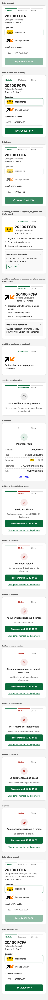

# @halifage/mobile-money

Mobile money collections and payouts for Cameroon. Talks to Orange Money and MTN MoMo directly, or through pawaPay,
and returns normalised outcomes. It stores nothing and settles nothing: your app persists the `ref`, confirms every payment with
`status()`, and settles.

Node 22+, ESM, no runtime dependencies.

```bash
npm install @halifage/mobile-money
```

## Usage

```ts
import { MobileMoneyError, orangeDirect, signCallbackUrl, verifyCallback } from '@halifage/mobile-money'

// one instance per process: it caches the provider token
const orange = orangeDirect({
  username: process.env.ORANGE_USERNAME!,
  password: process.env.ORANGE_PASSWORD!,
  authToken: process.env.ORANGE_AUTH_TOKEN!,
  merchantMsisdn: process.env.ORANGE_MERCHANT_MSISDN!,
  pin: process.env.ORANGE_PIN!,
})

// start a payment
try {
  const { ref } = await orange.collect({
    id: attempt.id, // your UUID, the idempotency key
    operator: 'orange',
    amount: 500,
    phone: '+237690000000',
    description: 'Order 42',
    callbackUrl: signCallbackUrl('https://app.example/api/momo/callback', attempt.id, process.env.CALLBACK_SECRET!),
  })
  // save ref on the attempt
} catch (error) {
  if (error instanceof MobileMoneyError && error.kind === 'uncertain') {
    // may have reached the provider: save error.ref when set and keep polling status()
  }
  // rejected: nothing moved, offer a retry with a new id
}

// callback route: the body is never trusted
export async function POST(request: Request) {
  const id = verifyCallback(request, process.env.CALLBACK_SECRET!)
  if (!id) return new Response(null, { status: 401 })
  const outcome = await orange.status(refForAttempt(id))
  // settle when outcome.status === 'completed'
  return new Response(null, { status: 204 })
}
```

## Outcomes

| `status()` result | Meaning |
|---|---|
| `{ status: 'completed', amount, currency }` | Paid. Check `amount` against what you asked for. |
| `{ status: 'failed', reason, code? }` | Final. `reason`: `insufficient_funds`, `declined`, `expired`, `wrong_number`, `unavailable`, `unknown`. |
| `{ status: 'pending', code? }` | Not final yet, including any status string the SDK does not know. Poll again. pawaPay sets `code: 'NOT_FOUND'` while the payer has not pressed Pay. |

## Errors

`MobileMoneyError` has `kind`, `code` and, when known, `ref`.

| `kind` | When | What to do |
|---|---|---|
| `rejected` | `collect` refused or nothing was sent (`invalid_input`, `TOKEN_FAILED`, provider 4xx) | No money moved. Retry with a new `id`. |
| `uncertain` | `collect` may have reached the provider (timeout, network error, 5xx) | Save `ref` if set and poll `status()`. Without `ref`, reconcile by hand. |
| `unavailable` | `status()` lookup failed | Retry later. |

## Providers

| Factory | Operators | Config |
|---|---|---|
| `orangeDirect` | `orange` | `username`, `password`, `authToken` (X-AUTH-TOKEN), `merchantMsisdn`, `pin`, `baseUrl?` (default `https://api-s1.orange.cm`) |
| `orangeWebPay` | `orange` | `clientId`, `clientSecret`, `merchantKey`, `environment` (`dev` sandbox in test currency `OUV`, or `cm`), `baseUrl?` (default `https://api.orange.com`) |
| `mtnDirect` | `mtn` | `subscriptionKey`, `apiUser`, `apiKey`, `environment` (`sandbox` or `mtncameroon`), `baseUrl?` |
| `pawaPay` | `mtn`, `orange` | `token` (API token from the pawaPay dashboard), `environment` (`sandbox` or `production`), `baseUrl?` |

- Orange wants a 9-digit local payer number; the SDK strips `+237`.
- `orangeWebPay` is redirect-based: pass `returnUrl`, then send the payer to the `redirectUrl` that `collect` returns,
  where they confirm with an Orange Money OTP. Its `ref` is opaque base64url (it carries the pay token, order id and
  amount the status call needs). No merchant PIN is involved. A lost `collect` reply is `rejected`: without the
  payment page the payer cannot pay.
- MTN requires `id` to be a UUID and uses it as the `ref`. Sandbox works in EUR and accepts MTN's test numbers.
- MTN `status()` returns `failed` with code `NOT_FOUND` for a payment MTN never received. After an `uncertain`
  collect, wait a few minutes before treating `NOT_FOUND` as final.

- `pawaPay` collects through its hosted Payment Page: pass `returnUrl`, send the payer to `redirectUrl`. `id` must be a
  UUID and is the `ref`; the payer's number is fixed on the page. A deposit stays `pending` with code `NOT_FOUND`
  until the payer presses Pay; the page expires after 15 minutes without a callback, so the caller decides when a
  long `NOT_FOUND` is dead. `callbackUrl` is ignored: pawaPay posts callbacks to the URLs set in its dashboard.

### Payouts

`pawaPay()` also implements `MobileMoneyPayouts`:

```ts
const { ref } = await provider.payout({ id: uuid, operator: 'orange', amount: 20000, phone: '+237693456789', message: 'Ecolage versement' })
await provider.payoutStatus(ref) // completed | failed (reason 'unknown', code = pawaPay failureCode) | pending
```

The recipient gets exactly `amount`; pawaPay takes its fee from your wallet. `message` (4–22 chars) is shown to the
recipient, else omitted. Re-sending the same `id` is safe (pawaPay answers `DUPLICATE_IGNORED`). `rejected` means
nothing was sent; `uncertain` (network error, 5xx, `UNKNOWN_ERROR`) carries `ref`: poll `payoutStatus`. A payout
pawaPay never received is `failed` with code `NOT_FOUND`.

### Callbacks

`parsePawaPayCallback(rawBody)` returns `{ kind: 'deposit' | 'payout' | 'refund', ref }` or `null`. It never returns a
status: call `status(ref)` or `payoutStatus(ref)`. Without callbacks configured, polling alone works.

Your app picks the provider per operator. To add another aggregator, implement
`MobileMoneyProvider` and run `describeProviderContract` from `test/contract.ts` against it.

## Checkout UI

A React checkout for the payer, at `@halifage/mobile-money/checkout`. It renders from a provider-neutral status your
app owns; it never calls a provider, polls or stores anything. French by default, English included, no Tailwind needed.

```bash
npm install @halifage/mobile-money react react-dom   # react >= 19, optional peer: only the checkout needs it
```

```tsx
import { Checkout, type CheckoutStatus } from '@halifage/mobile-money/checkout'
import '@halifage/mobile-money/checkout.css'

<Checkout
  amount={20100}                        // XAF, whole units
  payee="Collège La Réussite"
  status={status}                       // CheckoutStatus, from your app
  onPay={({ operator, phone }) => start(operator, phone)} // phone: '237' + 9 digits
/>
```

The root import `@halifage/mobile-money` stays React-free.

| Prop | |
|---|---|
| `amount`, `payee` | Shown on every step. |
| `status` | `CheckoutStatus` below. |
| `onPay({ operator, phone })` | Called by Payer and by Réessayer, once per tap until `status` changes. |
| `defaultOperator`, `defaultPhone` | Prefill, e.g. after a reload in a failed state. Any common phone format. |
| `summary` | Extra lines under the amount. |
| `actions` | Shown on success, e.g. a receipt link. |
| `locale` | `'fr'` (default) or `'en'`. |
| `messages` | Per-string overrides, e.g. `{ payButton: 'Régler {amount}' }`. |

| `status` | Shows |
|---|---|
| `{ status: 'idle' }` | Amount, operator tiles (follow the number's prefix), number field, Payer |
| `{ status: 'initiated' }` | Same form, disabled, spinner |
| `{ status: 'awaiting_customer', nextAction: { kind: 'approve_on_phone', operator } }` | 3 steps to approve on the phone, folded "Pas reçu la demande ?" help (MTN: dial `*126#`) |
| `{ status: 'awaiting_customer', nextAction: { kind: 'redirect', url } }` | "Redirection…", then `window.location.assign(url)` once |
| `{ status: 'pending_confirmation' }` | "Nous vérifions votre paiement" |
| `{ status: 'succeeded', reference, paidAt }` | Receipt rows, then `actions` |
| `{ status: 'failed', reason }` / `{ status: 'expired' }` | Reason message, one-tap retry to the same number, "Changer de numéro ou d'opérateur" |

The component keeps the operator and number itself; "Changer…" shows the form again until the next `onPay`. An error
before anything reached the operator is `failed` with reason `unknown`. Mapping a `collect()` result to `NextAction`:

```ts
const { ref, redirectUrl } = await provider.collect(request)
const nextAction: NextAction = redirectUrl
  ? { kind: 'redirect', url: redirectUrl }
  : { kind: 'approve_on_phone', operator: request.operator }
```

Theming: override these on `.mm-checkout` (classes are prefixed `mm-`). From 600 px of its own width the component
splits into two columns, summary left.

| Variable | Default |
|---|---|
| `--mm-accent` | `#0a6b3b` (active step, selected tile, main button) |
| `--mm-danger` | `#b3261e` |
| `--mm-fg` / `--mm-muted` | `#222` / `#6b6b6b` |
| `--mm-bg` / `--mm-border` | `#fff` / `#ddd` |
| `--mm-radius` | `12px` |
| `--mm-font` | `inherit` |



Logos: [MTN 2022 logo](https://commons.wikimedia.org/wiki/File:MTN_2022_logo.svg) and the
[Orange Money arrow mark](https://commons.wikimedia.org/wiki/File:Logo_Orange_Money.svg), both from Wikimedia Commons.
MTN, MoMo, Orange and Orange Money are trademarks of their owners. Swap in your merchant-kit files if you have them.

## Observed provider behaviour

- Orange (live, 2026-10-14): token, `mp/init` and TLS verification work as documented. `mp/pay` rejects an
  `orderId` over 20 characters with HTTP 422, so the SDK sends `id` without dashes, cut to 20. Status spellings:
  documented `PENDING` and `SUCCESSFULL`, plus `FAILED` seen in `data.status`. A wrong merchant PIN returns HTTP 417
  with `inittxnstatus` `00036` and **blocks the merchant account** (unblock with `#150*1#` from the merchant SIM), so
  check the PIN before going live. A completed (approved) payment has not been observed yet.

- Orange Web Payment: sandbox path `dev/v1` with currency `OUV`, production `cm/v1` with `XAF` (per open-source
  integrations; official reference is gated). Token path (`/oauth/v3/token`), `order_id` limits and status spellings
  are unconfirmed until a sandbox run.

- pawaPay sandbox (2026-10-18), all as mocked in the unit tests: `POST /v2/paymentpage` answers 201 with
  `redirectUrl` and accepts `phoneNumber` + `amountDetails` for CMR. The page shows the fixed number but still asks
  the payer to pick MTN or Orange. Deposit status is `NOT_FOUND` until Pay is pressed, then `FOUND` with `COMPLETED`
  or `FAILED` (`PAYMENT_NOT_APPROVED`, `INSUFFICIENT_BALANCE`) within seconds; amounts come back as `"100.00"`.
  Payouts answer `ACCEPTED` and settle within 5 s to `COMPLETED` or `FAILED` (`RECIPIENT_NOT_FOUND`,
  `WALLET_LIMIT_REACHED`). Callbacks were not exercised (none configured): polling only. A non-https `returnUrl`
  (`http://localhost`) is rejected with HTTP 400 `INVALID_PARAMETER`; 4xx errors carry `failureReason.failureCode`.

## Development

```bash
npm test          # vitest
npm run type-check
npm run lint      # biome
npm run build     # dist/
npm run smoke     # pack, install, import
npm run demo      # demo/index.html: every checkout state, static
```

Release: GitHub → Actions → **release** → Run workflow, pick the bump (`patch`/`minor`/`major`) and the branch. It
runs the checks, commits `chore: release X.Y.Z`, tags `vX.Y.Z`, pushes, publishes to npm with provenance and creates a
GitHub Release with generated notes. Picking `main` first fast-forwards `main` to `dev`; both end on the release
commit. If `dev` or `main` moves during the run, the push is rejected and nothing is published. npm auth is trusted
publishing, no token: once, on npmjs.com → package → Settings → Trusted publisher, add GitHub Actions with owner
`halifage`, repository `mobile-money`, workflow `release.yml`.

Live Orange test (moves real money): copy `.env.example` to `.env.live` (all `.env*` files except the example are
gitignored), fill in the Orange credentials, then:

```bash
cp .env.example .env.live
npm run build && node --env-file=.env.live scripts/live-orange.mjs 6XXXXXXXX 10
```

It prints every raw provider response with secrets redacted and polls `status()` for up to 3 minutes.

Orange Web Payment sandbox (no real money with `ORANGE_WEBPAY_ENVIRONMENT=dev`): fill the `ORANGE_WEBPAY_*` values in
`.env.live`, then open the printed payment URL and pay:

```bash
npm run build && node --env-file=.env.live scripts/live-orange-webpay.mjs 10
```

pawaPay sandbox (no real money): put `PAWAPAY_TOKEN` in `.env.live` (sandbox test numbers: docs.pawapay.io), then:

```bash
npm run build && node --env-file=.env.live scripts/live-pawapay.mjs collect 237653456789 100   # open the URL, pay
node --env-file=.env.live scripts/live-pawapay.mjs payout 237693456789 100
node --env-file=.env.live scripts/live-pawapay.mjs listen 8787                                  # callback bodies
```
